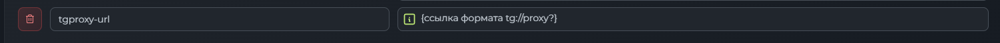

# Разработчикам и провайдерам

[Главная](https://github.com/BMray-proxy) · [Пользователям](users.md)

## Хосты с автовыбором и Xray JSON

BMray поддерживает хосты с автовыбором в готовых конфигурациях **Xray JSON**, включая связанные правила маршрутизации. Это отличается от сортировки обычных серверов по пингу в самом приложении: параметры автовыбора внутри JSON задаёт провайдер.

Для такого хоста панели нужно вернуть полный `XRAY_JSON`, а не только список ссылок в Base64. В обычной ссылке может оказаться локальный адрес-заглушка вместо готовой конфигурации.

Если в подписке есть такой сервер с автовыбором и BMray получает список ссылок с локальным адресом, приложение повторно обращается к панели с **User-Agent, начинающимся с Happ**, чтобы запросить Xray JSON. Это режим совместимости: в рассматриваемом наборе правил Remnawave формат `XRAY_JSON` по умолчанию назначен только `^happ`. Сам набор правил можно изменить; это не ограничение формата или ядра Xray. При уже корректном JSON дополнительный запрос не требуется. Для HTML-ответа также предусмотрен повтор с User-Agent Happ.

### Правило для BMray в Remnawave

1. Откройте **«Подписка» → «Правила ответов»**.
2. Добавьте следующее правило в массив `rules` **до `Fallback Base64`** и до других общих правил, которые могут перехватить запрос BMray.
3. Сохраните изменения и обновите подписку в BMray.

```json
{
  "name": "Xray JSON BMray",
  "description": "BMray теперь тоже поддерживает маршрутизацию",
  "enabled": true,
  "operator": "AND",
  "conditions": [
    {
      "headerName": "user-agent",
      "operator": "REGEX",
      "value": "^bmray",
      "caseSensitive": false
    }
  ],
  "responseType": "XRAY_JSON"
}
```

`^bmray` сопоставляет начало User-Agent без учёта регистра. Панель сразу выдаёт `XRAY_JSON` для штатного User-Agent BMray, поэтому повтор с Happ для получения этого формата больше не нужен. Если пользователь вручную поменял User-Agent, правило должно соответствовать фактическому значению.

Remnawave проверяет правила по порядку. Пустые `conditions` у fallback соответствуют любому запросу, поэтому fallback должен оставаться последним. Правило браузера сохранено первым.

### Полный пример правил ответов

[Скачать response-rules.json](response-rules.json)

Ниже приведён полный конфиг из примера. Правила других клиентов сохранены: наличие в этом списке Sing-box относится к совместимости панели с другими приложениями и не означает использование этого ядра в BMray. Описание старого правила Happ оставлено как в исходном примере; оно не ограничивает BMray, для которого добавлено отдельное правило.

Перед заменой всего конфига сохраните текущие правила панели и учтите собственные условия и модификации ответа.

```json
{
  "version": "1",
  "rules": [
    {
      "name": "Browser Subscription",
      "description": "System critical: do not delete or disable this rule.",
      "enabled": true,
      "operator": "AND",
      "conditions": [
        {
          "headerName": "accept",
          "operator": "CONTAINS",
          "value": "text/html",
          "caseSensitive": true
        }
      ],
      "responseType": "BROWSER"
    },
    {
      "name": "Mihomo Clients",
      "description": "Response with generated YAML config (Mihomo Template)",
      "enabled": true,
      "operator": "AND",
      "conditions": [
        {
          "headerName": "user-agent",
          "operator": "REGEX",
          "value": "^(?:flclash|flowvy|murge|mihomo|prizrak-box|koala-clash|clash(?:-verge|-nyanpasu|x meta|[-.]?meta))",
          "caseSensitive": false
        }
      ],
      "responseType": "MIHOMO"
    },
    {
      "name": "Stash (iOS, macOS)",
      "description": "Response with generated YAML config (Stash Template)",
      "enabled": true,
      "operator": "AND",
      "conditions": [
        {
          "headerName": "user-agent",
          "operator": "REGEX",
          "value": "^stash",
          "caseSensitive": false
        }
      ],
      "responseType": "STASH"
    },
    {
      "name": "Sing-box clients",
      "description": "Response with generated JSON config (Singbox template)",
      "enabled": true,
      "operator": "AND",
      "conditions": [
        {
          "headerName": "user-agent",
          "operator": "REGEX",
          "value": "^sfa|sfi|sfm|sft|karing|singbox",
          "caseSensitive": false
        }
      ],
      "responseType": "SINGBOX"
    },
    {
      "name": "Clash Core Clients",
      "description": "Response with generated YAML config (Clash Template)",
      "enabled": true,
      "operator": "AND",
      "conditions": [
        {
          "headerName": "user-agent",
          "operator": "REGEX",
          "value": "^clash",
          "caseSensitive": false
        }
      ],
      "responseType": "CLASH"
    },
    {
      "name": "Xray JSON clients",
      "description": "Только Happ: он единственный проверенно исполняет наш XRAY_JSON с маршрутизацией",
      "enabled": true,
      "operator": "AND",
      "conditions": [
        {
          "headerName": "user-agent",
          "operator": "REGEX",
          "value": "^happ",
          "caseSensitive": false
        }
      ],
      "responseType": "XRAY_JSON"
    },
    {
      "name": "Xray JSON BMray",
      "description": "BMray теперь тоже поддерживает маршрутизацию",
      "enabled": true,
      "operator": "AND",
      "conditions": [
        {
          "headerName": "user-agent",
          "operator": "REGEX",
          "value": "^bmray",
          "caseSensitive": false
        }
      ],
      "responseType": "XRAY_JSON"
    },
    {
      "name": "Fallback Base64",
      "description": "System critical: do not delete or disable this rule.",
      "enabled": true,
      "operator": "AND",
      "conditions": [],
      "responseType": "XRAY_BASE64"
    }
  ]
}
```

## Telegram Proxy: заголовок ответа tgproxy-url

Откройте в панели Remnawave **«Подписка» → «Настройки» → «Заголовки ответа»** и добавьте строку:

| Поле | Значение |
| --- | --- |
| Имя заголовка | `tgproxy-url` |
| Значение | Ссылка Telegram Proxy, например `tg://proxy?server=proxy.example&port=443&secret=EXAMPLE` |

Пример интерфейса настройки:



На скриншоте показано место ввода ссылки; текст в фигурных скобках — пояснение, его не нужно копировать как адрес.

Заголовок передаётся **в HTTP-ответе на загрузку подписки**. При валидной ссылке BMray показывает отдельную кнопку Telegram Proxy в карточке подписки. Она располагается рядом с Telegram-поддержкой либо занимает её место, если ссылка поддержки отсутствует. При нажатии открывается переданная ссылка. Если при следующем обновлении заголовок отсутствует, кнопка удаляется.

Поддерживаются HTTPS-ссылки и Telegram-ссылки `tg://proxy` / `tg://socks`. Для Telegram-ссылки укажите адрес сервера и допустимый порт. Публичные примеры должны содержать вымышленные адреса и ключи.

### Только для истёкшей или отключённой подписки

В поле значения заголовка можно использовать условный шаблон Remnawave:

```text
{{STATUS:ACTIVE=NIL | EXPIRED=[ССЫЛКА] | DISABLED=[ССЫЛКА] }}
```

Замените каждое `[ССЫЛКА]` на нужную ссылку Telegram Proxy целиком, без квадратных скобок.

| Статус подписки | Результат шаблона |
| --- | --- |
| ACTIVE | `NIL`: ссылка не передаётся, кнопка Telegram Proxy не появляется |
| EXPIRED | Ссылка из ветки `EXPIRED` |
| DISABLED | Ссылка из ветки `DISABLED` |

Для истёкшей и отключённой подписки можно указать разные ссылки. Подстановку статуса выполняет панель, а клиент получает уже готовый заголовок. Проверьте ответ для всех трёх статусов после сохранения: клиент сможет показать кнопку только если панель действительно вернёт заголовок и подходящий ответ подписки. Если правило панели возвращает ошибку или блокирует запрос, одного шаблона заголовка недостаточно.

## Проверка интеграции

1. С обычным User-Agent BMray проверьте, что ответ имеет формат Xray JSON и содержит ожидаемый хост с автовыбором и маршрутизацией.
2. Импортируйте и обновите подписку в BMray; проверьте подключение к хосту с автовыбором.
3. Для активного, истёкшего и отключённого тестового пользователя проверьте фактический `tgproxy-url` и наличие кнопки после обновления подписки.

Справка по порядку правил, условиям и `XRAY_JSON`: [Remnawave — Response Rules](https://docs.rw/learn-en/routing-rules/).
